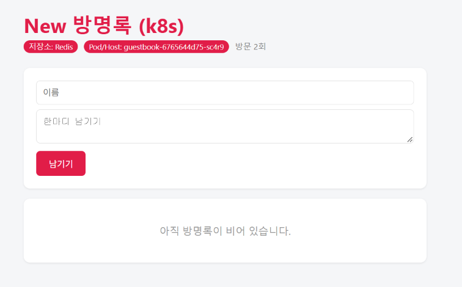

# Secret을 base64 -d로 읽은 화면
kubectl get secret guestbook-secret -o jsonpath='{.data.REDIS_PASSWORD}' | base64 -d; echo
devops1234

secret은 stringData의 값을 base64로 인코딩 하기 때문에 아무나 디코딩을 할 수 있어서 안전하지 않다

# # ConfigMap만 변경하여 제목 또는 색이 바뀐 화면 캡처

